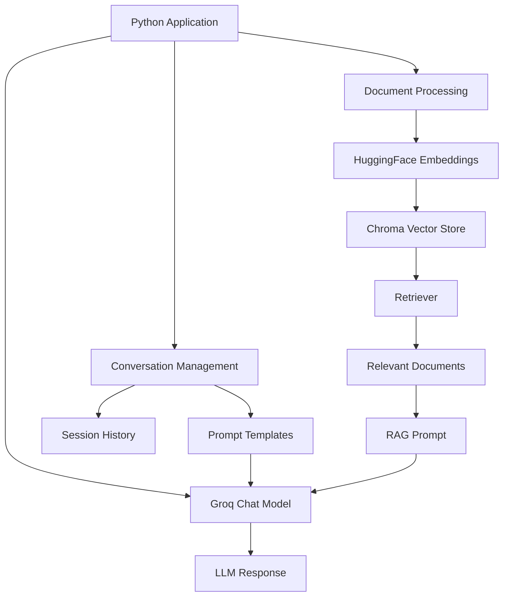
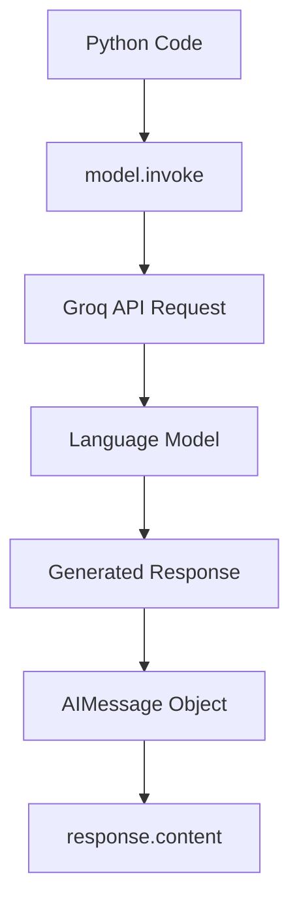
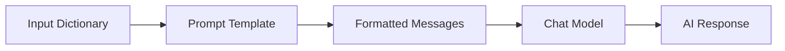
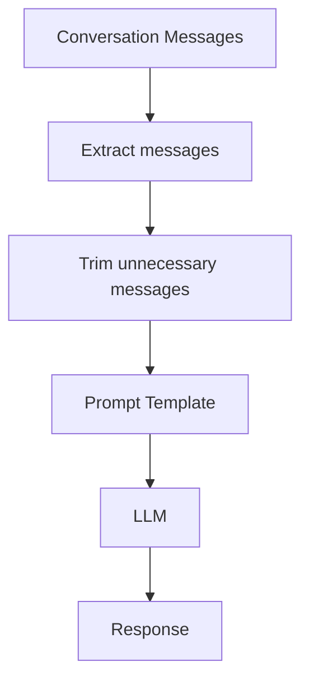
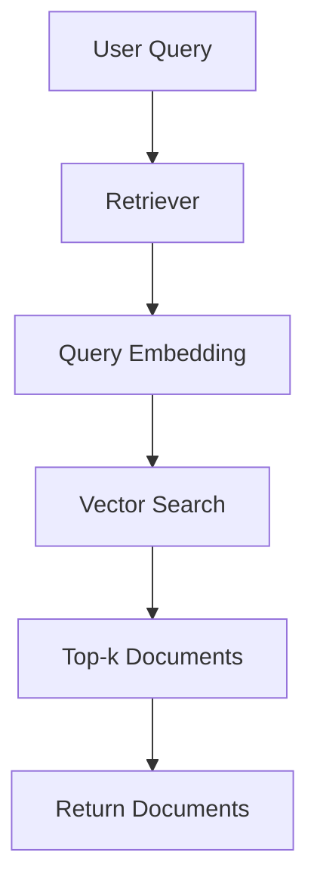
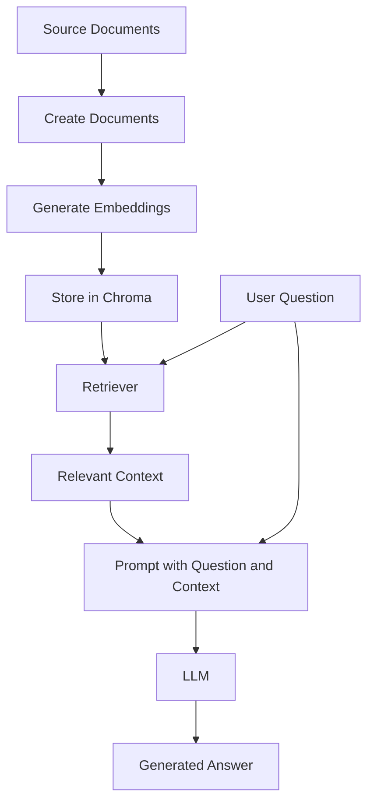
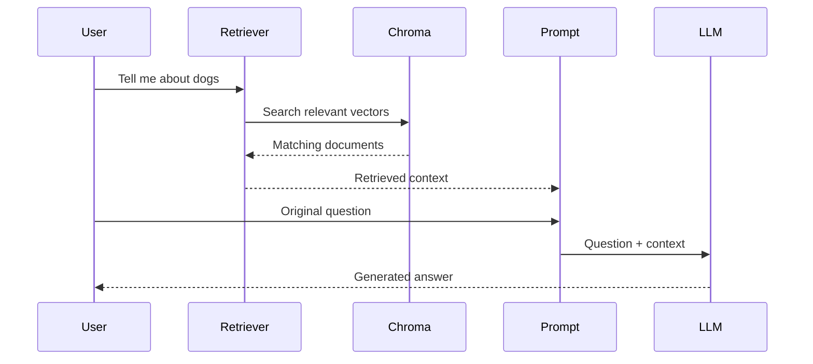
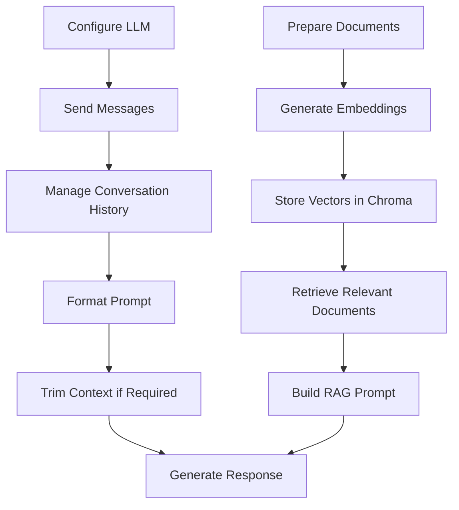

# LangChain LLM & RAG Learning

A hands-on learning repository covering LLM interaction, conversation history, prompt templates, context management, embeddings, vector databases, retrievers, and Retrieval-Augmented Generation (RAG) using Python and LangChain.

## Overview

This repository explains how to build the basic components of an AI application instead of treating LangChain as a collection of unrelated functions.

### What I learned

- Connecting an LLM using Groq and LangChain.
- Understanding human, AI, and system messages.
- Maintaining conversation history using session IDs.
- Creating dynamic prompts using `ChatPromptTemplate`.
- Connecting components using LangChain Expression Language (LCEL).
- Managing long conversations using `trim_messages`.
- Converting documents into embeddings.
- Storing and retrieving information using ChromaDB.
- Building retrievers for semantic search.
- Creating a basic RAG pipeline that answers questions using retrieved context.

## 1. Project Architecture



The project has two main workflows:

1. **Conversational AI:** The model receives messages, instructions, and optionally previous conversation history.
2. **RAG:** Documents are indexed, relevant information is retrieved, and the LLM uses that information to generate an answer.

---

# 2. Environment Setup

## Prerequisites

- Python
- VS Code
- A Groq API key
- Basic knowledge of Python functions, dictionaries, and lists

## Install dependencies

```bash
pip install langchain langchain-core langchain-community langchain-groq langchain-huggingface langchain-chroma chromadb sentence-transformers python-dotenv
```

Create a `.env` file in the project directory:

```env
GROQ_API_KEY=your_groq_api_key
HF_TOKEN=your_huggingface_token_if_required
```

`HF_TOKEN` is not used by the shown code, and a Hugging Face token is generally not needed to load a public embedding model such as `all-MiniLM-L6-v2`.

### Load environment variables

```python
import os
from dotenv import load_dotenv

load_dotenv()

groq_api_key = os.getenv("GROQ_API_KEY")
```

- `os`: Provides access to operating-system features, including environment variables.
- `load_dotenv()`: Loads values from the `.env` file.
- `os.getenv()`: Reads an environment variable.

**Security:** Never commit `.env` or expose API keys in your repository.

---

# 3. Connecting to an LLM

## What is an LLM?

A Large Language Model (LLM) is a model trained to process and generate human language. It can answer questions, summarize text, follow instructions, and generate content.

## What is Groq?

Groq provides infrastructure for running supported language models through an API.

## What is LangChain?

LangChain is a framework that helps developers connect language models with prompts, tools, documents, retrievers, and other application components.

LangChain is not itself the LLM.

### Initialize the model

```python
from langchain_groq import ChatGroq

model = ChatGroq(
    model="qwen/qwen3.8-27b",
    temperature=0.7
)
```

- `ChatGroq`: Provides a LangChain chat-model interface for Groq.
- `model`: Specifies the provider's model identifier. It must be supported by the provider.
- `temperature`: Controls randomness in generation. Higher values generally allow more varied responses.

The model identifier must be checked against the current Groq model catalogue if the request fails.

### Send a message

```python
from langchain_core.messages import HumanMessage

response = model.invoke([
    HumanMessage(content="Explain what an LLM is.")
])

print(response.content)
```

### How it works



`invoke()` executes the model call. The returned object contains the generated message, and `.content` accesses its text.

## Message types

| Message | Purpose |
|---|---|
| `HumanMessage` | Represents user input |
| `AIMessage` | Represents an AI response |
| `SystemMessage` | Provides instructions about the assistant's behaviour |

Example:

```python
from langchain_core.messages import HumanMessage, AIMessage

messages = [
    HumanMessage(content="My name is Aishwarya."),
    AIMessage(content="Hello, Aishwarya!"),
    HumanMessage(content="What is my name?")
]

response = model.invoke(messages)
print(response.content)
```

The model receives the complete list of messages supplied in this call.

**Important:** A normal model call does not automatically retain previous calls. Conversation history must be supplied or managed separately.

---

# 4. Conversation History and Memory

## The problem

Consider this conversation:

```text
User: I love travelling.
AI: That sounds great!
User: What do I love?
```

If the model receives only the final question, it may not know what the user said earlier.

To solve this, the application can store previous messages and provide them in later requests.

## ChatMessageHistory

```python
from langchain_community.chat_message_histories import ChatMessageHistory

history = ChatMessageHistory()

history.add_user_message("I love travelling")
history.add_ai_message("That's great!")

print(history.messages)
```

`ChatMessageHistory` stores the messages belonging to a conversation.

## The session store

```python
store = {}

def get_session_history(session_id: str):
    if session_id not in store:
        store[session_id] = ChatMessageHistory()

    return store[session_id]
```

Here, `store` is a Python dictionary mapping session IDs to their respective conversation histories.

Conceptually:

```text
store
 |
 +-- chat1
 |    +-- Human: I love travelling
 |    +-- AI: That's great!
 |
 +-- chat2
      +-- Human: Hello
      +-- AI: Hi!
```

Each session has a separate history.

## RunnableWithMessageHistory

```python
from langchain_core.runnables.history import RunnableWithMessageHistory

with_message_history = RunnableWithMessageHistory(
    model,
    get_session_history
)
```

This wrapper manages loading and updating the conversation history around calls to the underlying runnable.

### First request

```python
config = {
    "configurable": {
        "session_id": "chat1"
    }
}

response = with_message_history.invoke(
    [HumanMessage(content="I love travelling")],
    config=config
)
```

### Follow-up request

```python
response = with_message_history.invoke(
    [HumanMessage(content="What do I love?")],
    config=config
)
```

Since both requests use `chat1`, the wrapper can include the previous conversation when invoking the model.

### Why use a session ID?

The session ID identifies which conversation history should be used.

- Same ID: Continue the same conversation.
- Different ID: Use a separate conversation.

**Limitation:** The dictionary-based store is in-memory. Its data is lost when the Python process ends. Production applications generally require persistent storage and appropriate user/session access controls.

---

# 5. Prompt Templates

## What is a prompt?

A prompt is the information and instructions supplied to a language model.

A prompt may contain:

- Instructions
- Background context
- User input
- Output-format requirements

## ChatPromptTemplate

```python
from langchain_core.prompts import ChatPromptTemplate, MessagesPlaceholder

prompt = ChatPromptTemplate.from_messages([
    ("system", "You are a helpful assistant. Answer the question."),
    MessagesPlaceholder(variable_name="messages")
])
```

`ChatPromptTemplate` creates a structured chat prompt.

`MessagesPlaceholder` creates a slot for a list of messages that will be supplied at runtime.

### Example

```python
chain = prompt | model

response = chain.invoke({
    "messages": [
        HumanMessage(content="Explain machine learning.")
    ]
})
```

The prompt combines the system instruction with the supplied messages before passing the result to the model.

## Dynamic prompt variables

```python
prompt = ChatPromptTemplate.from_messages([
    ("system", "Answer the question in {language}."),
    MessagesPlaceholder(variable_name="messages")
])

chain = prompt | model

response = chain.invoke({
    "messages": [
        HumanMessage(content="Explain artificial intelligence.")
    ],
    "language": "Hindi"
})
```

The `{language}` placeholder is filled with the value `"Hindi"` at runtime.

This allows one prompt template to support different languages or other configurable instructions.

## LangChain Expression Language (LCEL)

```python
chain = prompt | model
```

The pipe operator connects the two components in sequence.



The chain is constructed first. It executes when `.invoke()` is called.

---

# 6. Combining Prompt Templates with Conversation History

```python
with_message_history = RunnableWithMessageHistory(
    chain,
    get_session_history,
    input_messages_key="messages"
)
```

`input_messages_key="messages"` tells the history wrapper which input field contains the new messages.

Example:

```python
config = {
    "configurable": {
        "session_id": "chat4"
    }
}

response = with_message_history.invoke(
    {
        "messages": [
            HumanMessage(content="I love travelling.")
        ],
        "language": "English"
    },
    config=config
)
```

The wrapper manages conversation history, while the prompt template also receives the language setting.

On a subsequent request, use the same session ID and supply only the new user message. Do not resend the entire history as new input messages unless intentionally testing a separate scenario.

---

# 7. Managing Long Conversations

## What is a context window?

A context window is the amount of information a model can process in a single request, measured in tokens.

Long conversations can contain too many messages to send efficiently. Old messages may be unnecessary for the current question.

## What is message trimming?

Message trimming removes some messages before they are passed to the model.

```python
from langchain_core.messages import trim_messages

trimmer = trim_messages(
    max_tokens=70,
    strategy="last",
    token_counter=len,
    include_system=True,
    allow_partial=False,
    start_on="human"
)
```

### Parameters

| Parameter | Meaning |
|---|---|
| `max_tokens` | The configured limit for the trimmer's counting strategy |
| `strategy="last"` | Retains the most recent messages that fit |
| `token_counter=len` | Counts messages, not actual language-model tokens |
| `include_system=True` | Preserves the initial system message when trimming |
| `allow_partial=False` | Avoids partially retaining a message |
| `start_on="human"` | Tries to begin the retained sequence with a human message |

**Important correction:** With `token_counter=len`, the value `70` does not mean 70 actual LLM tokens. It counts messages for this trimming strategy. Use an appropriate model-aware token counter if you need a genuine token budget.

### Example pipeline

```python
from operator import itemgetter
from langchain_core.runnables import RunnablePassthrough

chain = (
    RunnablePassthrough.assign(
        messages=itemgetter("messages") | trimmer
    )
    | prompt
    | model
)
```

`RunnablePassthrough.assign()` preserves the input dictionary and replaces or adds its `messages` field with the trimmed message list.

`itemgetter("messages")` extracts that field.

The resulting flow is:



For a history-enabled application, trimming should happen before the model receives the full history. Preserve any essential instructions and context when choosing a trimming strategy.

---

# 8. Documents and Metadata

## What is a Document?

LangChain's `Document` object represents a piece of text together with optional metadata.

```python
from langchain_core.documents import Document

documents = [
    Document(
        page_content="Dogs are loyal and friendly companions.",
        metadata={"source": "mammal-pets-doc"}
    ),
    Document(
        page_content="Cats are independent pets.",
        metadata={"source": "mammal-pets-doc"}
    ),
    Document(
        page_content="Goldfish are popular pets for beginners.",
        metadata={"source": "fish-pets-doc"}
    )
]
```

Each document has two important fields:

- `page_content`: The actual text.
- `metadata`: Additional information about the text, such as source, page number, category, or document ID.

Metadata can help identify sources, filter documents, and provide traceability.

In a larger RAG system, documents are often split into smaller chunks before embedding.

---

# 9. Embeddings

## What is an embedding?

An embedding converts text into a numerical vector that represents aspects of its meaning.

For example:

```text
"Dogs are friendly pets."
        |
        v
Embedding Model
        |
        v
[0.12, -0.08, 0.31, ...]
```

Similar texts can have vectors that are close to one another in the embedding space.

This makes meaning-based retrieval possible even when a query and a document do not use exactly the same words.

## Hugging Face Embeddings

```python
from langchain_huggingface import HuggingFaceEmbeddings

embeddings = HuggingFaceEmbeddings(
    model_name="all-MiniLM-L6-v2"
)
```

This uses a sentence-transformer embedding model.

The model can run locally, so embedding generation does not necessarily require a paid embedding API. Initial model downloads and local resource usage still apply.

**Important distinction:** The embedding model and the chat LLM have different jobs.

| Embedding model | Chat LLM |
|---|---|
| Converts text into vectors | Generates language responses |
| Supports similarity search | Answers questions and follows instructions |
| Example: `all-MiniLM-L6-v2` | Example: a supported Qwen model through Groq |

---

# 10. Vector Stores and ChromaDB

## What is a vector store?

A vector store stores embeddings alongside the associated documents and provides operations for finding similar vectors.

```python
from langchain_chroma import Chroma

vectorstore = Chroma.from_documents(
    documents,
    embedding=embeddings
)
```

Conceptually, this performs the following steps:

1. Reads the documents.
2. Generates embeddings for their text.
3. Stores the vectors and associated document information in Chroma.
4. Makes similarity search available.

## Similarity search

```python
results = vectorstore.similarity_search("cat")
```

This retrieves documents whose vectors are similar to the query embedding.

The result is a list of `Document` objects, not a generated natural-language answer.

### Search with a limit

```python
results = vectorstore.similarity_search(
    "cat",
    k=2
)
```

`k=2` requests the two most similar results.

### Similarity search with scores

```python
results = vectorstore.similarity_search_with_score("cat")
```

This returns document-score pairs.

**Important:** The score's interpretation depends on the vector store and distance metric. For Chroma's common distance-based results, a lower distance generally indicates a closer match; do not assume every returned score is a similarity percentage.

### Asynchronous search

```python
results = await vectorstore.asimilarity_search("cat")
```

The `await` keyword is used in an asynchronous Python context. It lets the application await the search operation without blocking in the same way as a synchronous call.

The synchronous and asynchronous methods aim to retrieve similar documents, but their calling styles differ.

---

# 11. Retrievers

## What is a retriever?

A retriever is a component that takes a query and returns relevant documents.

A vector store provides storage and search operations. A retriever offers a standardized interface for retrieving documents, often using a vector store underneath.

### Method 1: RunnableLambda

```python
from langchain_core.runnables import RunnableLambda

retriever = RunnableLambda(
    vectorstore.similarity_search
).bind(k=1)

results = retriever.batch(["cat", "dog"])
```

- `RunnableLambda` wraps a Python function as a runnable.
- `.bind(k=1)` supplies the `k=1` argument to the wrapped function.
- `.batch()` processes multiple inputs and returns corresponding outputs.

### Method 2: `as_retriever()`

```python
retriever = vectorstore.as_retriever(
    search_type="similarity",
    search_kwargs={"k": 1}
)
```

This creates a retriever using similarity search and requests one document per query.

You can call it with:

```python
results = retriever.invoke("cat")
```

Or:

```python
results = retriever.batch(["cat", "dog"])
```

### Retriever workflow



The retriever finds relevant context. It does not, by itself, generate the final answer using an LLM.

---

# 12. Retrieval-Augmented Generation (RAG)

## What is RAG?

Retrieval-Augmented Generation combines information retrieval with language generation.

Instead of relying only on information available in the model's learned parameters, the application retrieves relevant external information and supplies it as context for answering the question.

### Example problem

Suppose the application has a small collection of documents about pets.

User question:

> Tell me about dogs.

The retriever searches the collection and returns a relevant document:

> Dogs are great companions, known for their loyalty and friendliness.

The LLM receives the question and retrieved text, then generates an answer based on that context.

## RAG architecture



## RAG implementation

### Step 1: Create the prompt

```python
from langchain_core.prompts import ChatPromptTemplate

message = """
Answer the question using the provided context only.

Question:
{question}

Context:
{context}
"""

prompt = ChatPromptTemplate.from_messages([
    ("human", message)
])
```

The template includes two variables:

- `{question}`: The user's question.
- `{context}`: The retrieved information.

The instruction asks the model to answer using the supplied context only.

### Step 2: Connect retrieval and generation

```python
from langchain_core.runnables import RunnablePassthrough

rag_chain = (
    {
        "context": lambda x: retriever.invoke(x["question"]),
        "question": lambda x: x["question"]
    }
    | prompt
    | llm
)
```

Explanation:

- The `context` function retrieves documents using the question.
- The `question` function passes the original question forward.
- The prompt combines both values.
- The LLM generates the answer.

`RunnablePassthrough` is imported in this code but is not actually used in this particular chain definition.

### Step 3: Ask a question

```python
response = rag_chain.invoke({
    "question": "Tell me about dogs"
})

print(response.content)
```

### Execution flow



## What does RAG improve?

- It lets an application use external documents as context.
- It can provide information not included in the original model prompt.
- It makes it possible to build document question-answering applications.
- It can support source-grounded answers when source tracking and citation logic are implemented.

**Important:** RAG does not guarantee correctness. The retriever may return irrelevant documents, and the LLM may still generate unsupported claims. The application should evaluate retrieval quality, answer relevance, and faithfulness to the retrieved context.

The current implementation does not yet implement source citations, reranking, hybrid search, or a formal evaluation pipeline.

---

# 13. Common Mistakes and Important Lessons

| Mistake | Correct understanding |
|---|---|
| Assuming the model remembers every call | Previous messages must be supplied or managed through history |
| Confusing LangChain with an LLM | LangChain orchestrates components; the LLM generates responses |
| Assuming `ChatMessageHistory` is permanent storage | The in-memory example loses data when the process ends |
| Treating embeddings as generated answers | Embeddings are numerical representations used for retrieval |
| Assuming a vector store generates answers | It retrieves documents; the LLM generates the answer |
| Assuming `k=1` guarantees the right document | It returns one result, which may still be irrelevant |
| Assuming `len` counts model tokens | It counts messages in the shown trimming configuration |
| Assuming RAG guarantees factual answers | Retrieval and generation both require evaluation |
| Uploading API keys to GitHub | Keep secrets in environment variables and exclude `.env` |

---

# 14. End-to-End Summary



## Key takeaways

- `ChatGroq` connects the application to a supported Groq chat model.
- `HumanMessage`, `AIMessage`, and `SystemMessage` represent different message roles.
- `RunnableWithMessageHistory` helps maintain conversation history for a session.
- `ChatPromptTemplate` and `MessagesPlaceholder` create structured prompts.
- LCEL connects components into reusable pipelines.
- `trim_messages` helps manage long conversation histories.
- Embeddings represent text as vectors.
- ChromaDB stores vectors and supports similarity search.
- Retrievers return relevant documents.
- RAG combines retrieval with LLM-based generation.

## Next steps

To improve this into a more complete AI engineering project:

1. Add document loading and chunking.
2. Persist the Chroma vector store.
3. Experiment with different `top-k` values.
4. Evaluate retrieval relevance and answer faithfulness.
5. Add source citations to generated answers.
6. Explore reranking and hybrid search.
7. Build a user-facing document question-answering application.

---

## Repository Structure

```text
langchain-llm-rag-learning/
├── README.md
├── main.py
├── requirements.txt
├── .env.example
└── .gitignore
```

`main.py` contains the executable experiments, while this README explains their concepts and how the components work together.

This repository is a learning project intended to build a foundation for more advanced RAG applications and AI engineering workflows.
